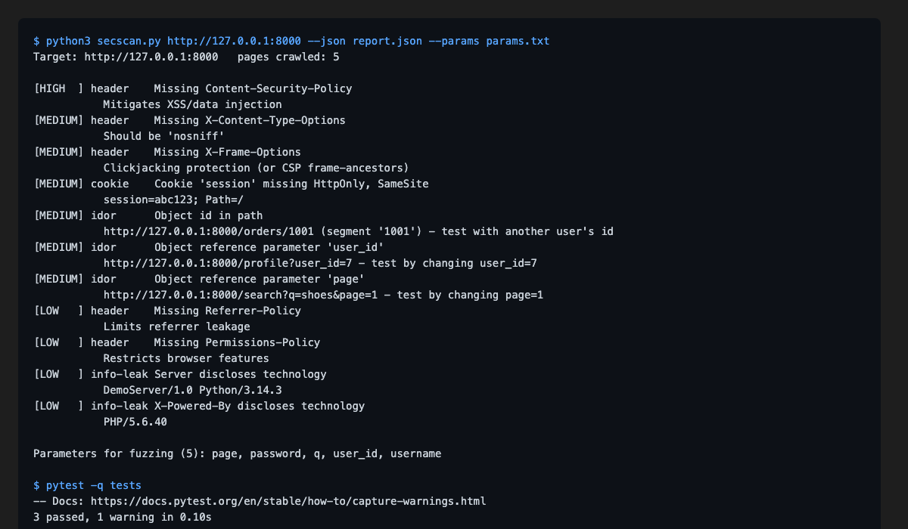

# secscan

A lightweight Python CLI that automates three repetitive AppSec checks:

1. **Security headers**: missing CSP, X-Content-Type-Options, X-Frame-Options, Referrer-Policy, Permissions-Policy, HSTS (over TLS), unsafe CSP directives, technology-leaking headers, and cookie flags (HttpOnly, SameSite, Secure).
2. **IDOR patterns**: numeric/UUID ids in paths and object-reference query parameters (`id`, `user_id`, `order_id`...), flagged for manual testing with a second account.
3. **Parameter harvesting**: collects query params and form fields across crawled pages into a wordlist for fuzzing (ffuf, Burp Intruder).

> Only scan systems you own or have written permission to test.

## Install
```bash
git clone <repo> && cd secscan
python3 -m venv .venv && source .venv/bin/activate
pip install -r requirements.txt
```

## Usage
```bash
python secscan.py http://127.0.0.1:8000 --json report.json --params params.txt
```
Exit code is 1 when a High finding exists, so it can gate CI.

## Demo against the local test target
```bash
python demo/vuln_target.py &          # deliberately weak server on 127.0.0.1:8000
python secscan.py http://127.0.0.1:8000
pytest -q tests
```


Sample outputs: [report.json](docs/report.json), [params.txt](docs/params.txt).

## Limitations
IDOR flags are candidates, not confirmed vulnerabilities (e.g. `page=1` is a false positive). It does not authenticate or fuzz.

Resume bullet: *Built a Python AppSec scanner auditing HTTP security headers, cookie flags and IDOR-prone endpoints with parameter harvesting for fuzzing; detected 11 issues on a test target and gates CI via exit codes.*
